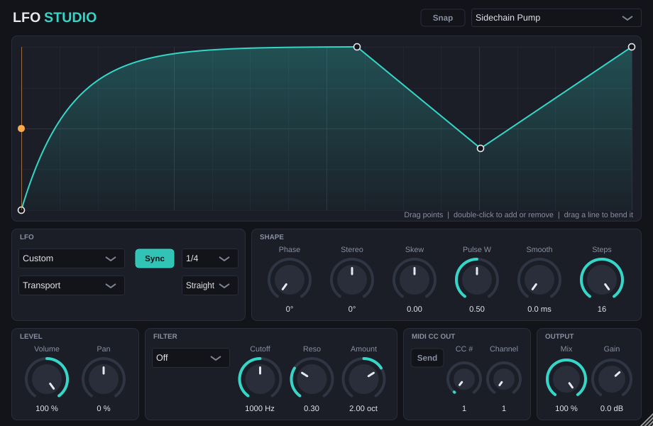

# LFO Studio

A VST3 modulation effect built with [JUCE](https://juce.com). One LFO drives volume, pan, a filter and a MIDI CC at the same time, so it covers tremolo, sidechain-style pumping, auto-pan, trance gates, filter wobbles and controlling other gear or plugins over MIDI.



## Features

**Shapes** — Sine, Triangle, Saw Up, Saw Down, Square (with pulse width), Exp Up, Exp Down, Sample & Hold, Smooth Random, Steps (2–16 step sequencer) and Custom (draw your own curve).

**Timing**

- Tempo sync from 8 bars down to 1/64, straight, dotted or triplet, or a free rate from 0.01 to 40 Hz.
- Four trigger modes:
  - **Free** runs continuously.
  - **Transport** locks to the host's song position, so the shape always lands on the same beat.
  - **Retrigger** restarts the cycle on every MIDI note.
  - **One-Shot** plays one cycle per MIDI note and then holds, like an envelope.

**Shaping** — phase offset, stereo phase offset (right channel runs ahead of or behind the left), skew (pushes the shape towards the start or end of the cycle) and smoothing (removes clicks from hard edges).

**Targets**

| Target | What it does |
| --- | --- |
| Volume | Tremolo / ducking. Negative amounts invert the shape. |
| Pan | Moves the signal left and right. |
| Filter | Low-pass, high-pass or band-pass, swept by up to ±5 octaves around the cutoff. |
| MIDI CC | Sends the LFO as a controller (any CC number and channel). |

Plus dry/wet mix, output gain, 12 factory presets and a resizable interface with an animated playhead.

**Drawing shapes**

- *Custom*: drag points to move them, double-click to add or remove a point, drag a line up or down to bend it.
- *Steps*: click and drag across the display to set step levels.
- *Snap* locks edits to a grid.

## Getting the plugin

Every push builds the plugin for Windows, macOS and Linux with GitHub Actions. Open the **Actions** tab, pick the latest run and download the artifact for your system, then copy `LFO Studio.vst3` to:

| System | Folder |
| --- | --- |
| Windows | `C:\Program Files\Common Files\VST3` |
| macOS | `~/Library/Audio/Plug-Ins/VST3` |
| Linux | `~/.vst3` |

Rescan plugins in your DAW and load **LFO Studio** as an audio effect. The macOS build is not signed or notarised, so macOS may refuse to load a downloaded copy until you build it yourself or remove the quarantine flag.

## Building it yourself

You need CMake 3.22 or newer and a C++17 compiler (Visual Studio 2022, Xcode, or GCC/Clang). JUCE is downloaded automatically during configuration.

```bash
cmake -S . -B build -DCMAKE_BUILD_TYPE=Release
```

```bash
cmake --build build --config Release
```

The plugin ends up in `build/LfoStudio_artefacts/Release/VST3`, next to a standalone app for trying it without a DAW.

On Linux, install the JUCE dependencies first:

```bash
sudo apt-get install libasound2-dev libx11-dev libxext-dev libxrandr-dev libxinerama-dev libxcursor-dev libxcomposite-dev libfreetype-dev libfontconfig1-dev libgl1-mesa-dev
```

Run the tests with:

```bash
ctest --test-dir build -C Release --output-on-failure
```

## Notes

- **MIDI in and out of an effect depends on the host.** Retrigger, One-Shot and MIDI CC output need your DAW to route MIDI to and from an audio effect. Most do (Ableton Live, Bitwig, Reaper, Cubase, FL Studio); how you set it up differs per DAW.
- A VST3 cannot directly modulate parameters of *other* plugins. To do that, send the MIDI CC output to the other plugin and use its MIDI learn.
- Tempo sync assumes 120 bpm when the host gives no tempo (for example in the standalone app).
- This was completely vibe-coded with Fable 5.2 by Antrhopic.

## Project layout

| Path | Contents |
| --- | --- |
| `Source/LfoEngine.h` | Shape maths, filter and gain mapping. No JUCE dependency. |
| `Source/PluginProcessor.*` | Parameters, presets, state, audio and MIDI processing. |
| `Source/PluginEditor.*` | Interface, look and feel, shape editor. |
| `Tests/` | Engine tests and headless end-to-end processor tests. |

## Licence

JUCE is dual-licensed (AGPLv3 or a commercial licence). If you distribute this plugin, either release it under the AGPLv3 or get a JUCE licence that fits your case.
